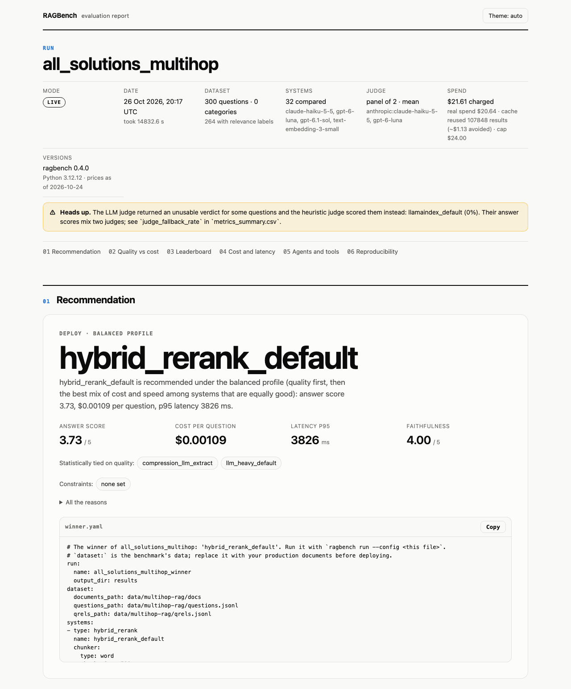
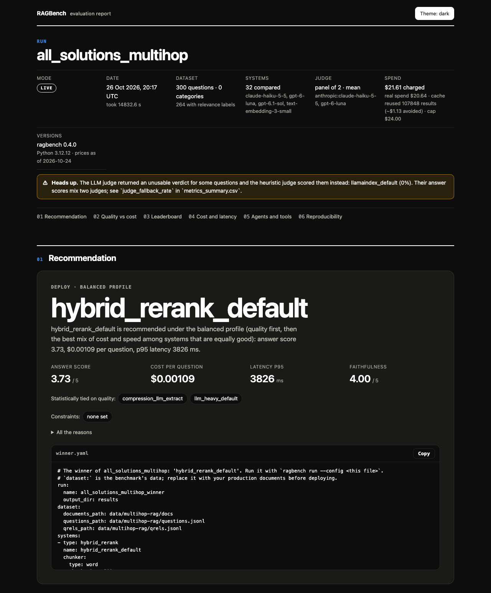

# RAGBench

[](https://github.com/alexandre0sheva/ragbench/actions/workflows/ci.yml)
[](https://www.python.org/downloads/)
[](LICENSE)
[](https://github.com/astral-sh/ruff)
[](https://peps.python.org/pep-0561/)

**RAGBench tells you which retrieval-augmented generation setup to deploy for *your* documents and *your* questions.** It runs many architectures (lexical, vector, hybrid, reranked, LLM-driven, tool-using agents, decision-gated abstention and more) on the same data, scores retrieval, answers, cost and latency with confidence intervals, and ends with a recommendation and a runnable `winner.yaml`.

It is not a demo chatbot, and it needs no API key to try: without one it runs on deterministic mock models so you can see the whole pipeline first.

*Not to be confused with* Galileo's [RAGBench](https://arxiv.org/abs/2407.11005) (arXiv 2407.11005, `rungalileo/ragbench`), a labelled dataset for RAG evaluation. This project is a tool that benchmarks RAG systems on your own data; it can read datasets like that one, and it shares only the name.

## Quickstart

```bash
pip install ragbench                      # or try it with no install: uvx ragbench demo
ragbench auto --docs ./my_docs --mock     # drop --mock for a real run: it estimates the cost and asks before spending
```

From a clone, `pip install -e .` installs the same thing; without Python, `docker run --rm ragbench demo` uses the image built from the [Dockerfile](Dockerfile) (`docker build -t ragbench .`; mount your working directory with `-v "$PWD":/work` and pass keys with `-e OPENAI_API_KEY`).

`auto` profiles your documents, writes questions from them if you have none (flagged `needs_review`; bring your own with `--questions`), runs a preset of systems, and prints the recommended one with the paths of `winner.yaml`, `report.html` and `recommendation.md`. If it stops, `ragbench auto --resume RUN_DIR` continues without paying again. Prefer to write the config yourself? `ragbench init my_ds --docs ./my_docs` scaffolds one; `ragbench demo` and `ragbench run --config configs/all.yaml --mock` run the bundled demo. `ragbench demo --suite hard` and `configs/hard.yaml` are a harder bundled suite built to separate systems.

Not sure which architecture to try first, or what to look at in the report? Start with [Choosing an architecture](docs/choosing-an-architecture.md).

## What you get

Each run writes one directory: a **recommendation** (which system to deploy under your constraints, the systems statistically tied with it, a runnable `winner.yaml`), a self-contained **`report.html`** (leaderboard with confidence whiskers, quality-against-cost chart, category heatmap, cost and latency by stage, failure types, and a drill-down into every question with the retrieved passages and the agent's steps), `leaderboard.md`, and the CSV and JSONL files all of it is built from. `ragbench report RUN` rebuilds any report from those files, `ragbench runs` lists past runs and `ragbench compare-runs A B` flags regressions.

<p>
  
  
</p>

`report.html` follows the OS theme, has a light/dark toggle, and works on a phone-sized screen.

### Where the results are

| Looking for | Go to |
| --- | --- |
| The current benchmark: every system on one public dataset (October 2026) | [MultiHop-RAG](docs/benchmarks/multihop-rag.md); its top is the table below |
| Every published run's table, filterable | the docs site's [Leaderboard](https://alexandre0sheva.github.io/ragbench/leaderboard/) |
| Which page or folder holds what, and how to read a leaderboard | [Where the results are](docs/finding-results.md) |
| Your own run | `results/<run>/report.html` (open it in a browser) and `leaderboard.md` |

### A published result

<!-- results:multihop-rag:start -->
Every RAG solution RAGBench can run, on 300 questions of the public [MultiHop-RAG](https://github.com/yixuantt/MultiHop-RAG) dataset (multi-hop questions over a corpus of news articles, null queries included), `gpt-6-luna` generating and `claude-haiku-5-5` judging. The top five, the recommended system, the floor and the 50k-token long-context entry, the three framework pipelines and the three agent harnesses:

| System | Answer score | Recall@5 | $ / question |
| --- | --- | --- | --- |
| `llm_heavy_default` | 3.83 [3.73, 3.94] | 0.667 | $0.00983 |
| `hybrid_rerank_default` (recommended) | 3.73 [3.61, 3.83] | 0.668 | $0.00109 |
| `compression_llm_extract` | 3.72 [3.57, 3.85] | 0.640 | $0.00112 |
| `corrective_default` | 3.68 [3.57, 3.79] | 0.637 | $0.00100 |
| `rerank_default` | 3.65 [3.54, 3.76] | 0.660 | $0.00108 |
| `no_retrieval_floor` | 1.90 [1.76, 2.05] | — | $0.00021 |
| `full_context_50k` | 3.41 [3.29, 3.53] | 0.642 | $0.00581 |
| `langchain_default` | 2.85 [2.73, 2.98] | 0.588 | $0.00088 |
| `llamaindex_default` | 2.60 [2.46, 2.73] | 0.591 | $0.00176 |
| `haystack_default` | 2.71 [2.57, 2.84] | 0.579 | $0.00115 |
| `claude_code`† | 3.55 [3.35, 3.76] | 0.632 | $0.01353 |
| `codex`† | 2.92 [2.73, 3.12] | 0.473 | $0.01598 |
| `opencode_glm`† ‡ | 3.64 [3.50, 3.77] | 0.656 | $0.01023 |

Brackets are 95% confidence intervals. † on a stratified 150 of the questions in a run of their own, so compare them with the others on [their own table](docs/benchmarks/multihop-rag.md#agent-harnesses). [The full leaderboard](docs/benchmarks/multihop-rag.md) has all 35 entries with significance tests, per-category winners, six open-weight generators and the limitations; [the demo-dataset example](docs/example-run.md) shows what one run produces. ‡ OpenCode's cost is its own estimate at OpenRouter's cheapest catalog price; OpenRouter probably billed 2.74–4.25× that, about $0.028–$0.043 a question ([correction](docs/benchmarks/multihop-rag.md#opencodes-cost)).

What the results show beyond the ranking ([patterns](docs/benchmarks/multihop-rag.md#patterns-across-the-runs)):

- **Temporal questions are the hardest**: the retrieving systems average 2.77 on them, and 7 of the 11 questions no system answers well are temporal.
- **The null queries separate the systems most.** The frameworks' tutorial pipelines answer many of them anyway (0.59 to 2.22, against 4.37 for `hybrid_default`), which is most of their gap.
- **Spending more per question does not buy a better answer**: across the 31 retrieving systems, cost per question and answer score have a rank correlation of 0.02.
<!-- results:multihop-rag:end -->

## Systems

<!-- systems:start -->
| System | Description | Typical use |
| --- | --- | --- |
| `bm25` | Lexical BM25 over chunks | Cheap baseline and exact-term matching |
| `hybrid` | BM25 + vector search fused with (optionally weighted) Reciprocal Rank Fusion | Balanced lexical + semantic retrieval |
| `hybrid_rerank` | Hybrid BM25 + vector RRF retrieval followed by a reranking pass | Recall of hybrid plus rerank precision |
| `no_retrieval` | The model answers from its own knowledge with no documents at all (the floor baseline) | Showing how much retrieval helps and how often the model makes things up without it |
| `parent_doc` | Retrieve small child chunks, answer from their larger parent chunks | Better answer context with precise retrieval |
| `rerank` | Vector retrieval followed by a reranking pass | Higher precision context selection |
| `sentence_window` | Search single sentences, then hand the generator each matched sentence with the sentences around it | Precise matching with enough surrounding text to answer from |
| `vector` | Embedding search with cosine similarity over a pluggable vector backend (exact NumPy by default) | Semantic baseline |
| `external_http` | Your own RAG service: each question is sent to an HTTP endpoint and the JSON reply (answer, passages, usage, cost) is mapped with JSONPath | Benchmarking a RAG you already run (any stack) against the built-in systems |
| `late_interaction` | Per-token embeddings scored by MaxSim (ColBERT): reranks hybrid or BM25 candidates, or searches every chunk exactly | Questions whose wording must match precisely (names, terms of art) where one pooled vector per chunk blurs the detail |
| `python_callable` | Your own pipeline, called in-process: a function `(question, top_k)` returning a dict (answer, passages, usage, cost) or an `AnswerResult` | Benchmarking your own code or a framework pipeline against the built-in systems without deploying it |
| `compression` | Hybrid retrieval of `candidate_k` candidates, each cut down to the sentences that bear on the question (LLM quotes, an embedding filter or a decision model), then packed to a token budget | Long or noisy chunks where most of each passage is beside the point; smaller prompts on long contexts |
| `decompose` | The LLM splits a complex question into sub-questions; each is searched (optionally in sequence, feeding earlier answers forward), then one answer is synthesized from all the evidence | Multi-part, comparison and multi-hop questions |
| `hyde` | Hypothetical Document Embeddings: the LLM writes a hypothetical answer used as the search probe | Short or vaguely-worded questions |
| `rag_fusion` | The LLM writes alternative queries; each is searched (hybrid or vector) and the rankings are merged with Reciprocal Rank Fusion | Questions worded differently from the documents |
| `contextual` | An LLM situates each chunk within its document at ingestion; the context is embedded and BM25-indexed with the chunk, then hybrid RRF retrieval | Corpora where chunks lose their meaning out of context (many similar documents, pronouns, section-relative facts) |
| `hierarchical` | Choose documents first from LLM-written summaries and titles, then retrieve chunks only inside the chosen documents | "Which document?" questions and corpora too large to search chunk by chunk |
| `raptor` | Chunks clustered and summarised by an LLM, recursively, into a tree; the question is matched against chunks and summaries of every level | Questions that need the gist of several related passages, and corpora where one fact is spread over many chunks |
| `adaptive` | Routes each question to the best of several configured pipelines (exact identifiers to BM25, comparisons to decomposition, calculations to a tool agent, the rest to the default) | Mixed workloads where no single architecture is best for every question |
| `decision_gate` | Hybrid + rerank retrieval, then a typed decision model drops chunks that do not help answer the question and abstains when the rest is not enough | Corpora where many questions have no answer in the documents, and a confident wrong answer costs more than a refusal |
| `full_context` | Puts whole documents (the whole corpus when it fits) in the prompt, most relevant first by BM25, up to a token budget (the ceiling baseline: do you need retrieval at all?) | Small corpora, and measuring how much a retrieval pipeline loses against reading everything |
| `graph_rag` | An LLM extracts entities and relations from every chunk at ingestion and writes a report per graph community; `local` follows the question's entities to their chunks, `global` answers by map-reduce over the community reports | Questions that connect entities across documents (`local`) and corpus-wide questions about themes and groups (`global`) |
| `agent_search` | A function-calling agent that searches the corpus and calls its configured tools (calculator, date_calc, corpus_grep, ...), then writes the cited answer | Questions that need computation, exact lookups, or several searches |
| `cli_agent` | An agent harness (Claude Code, Codex, OpenCode or any command) answers each question by searching a read-only copy of the corpus in a fresh workspace | Measuring a coding-agent harness as a RAG system: how well, how fast and at what cost it finds the answer in your documents |
| `corrective` | Retrieve, grade each chunk with the LLM, and when too little is relevant rewrite the query and widen the search; optional answer self-check | Corpora where the first search often misses and a bad context should be noticed rather than answered from |
| `grep_agent` | An index-free agent: it lists, greps and reads the raw documents with tools. No chunking, no embeddings, no vector store | Small or exact-match-heavy corpora, and testing whether you need retrieval infrastructure at all |
| `iterative` | Search, ask the LLM what is known and what is missing, search for the missing part, and repeat until it says it is done or the hop limit is reached | Multi-hop questions whose second search depends on what the first one found |
| `llm_heavy` | LLM-driven ingestion metadata, query rewriting, and reranking | Higher-cost, quality-oriented experiments |
<!-- systems:end -->

Every system implements the same interface and runs on any dataset. Options and trade-offs: [docs/systems.md](docs/systems.md).

## Documentation

- [Choosing an architecture](docs/choosing-an-architecture.md): which systems to try for your corpus, questions, budget and privacy needs, and how to read the result
- [Configuration](docs/configuration.md): config sections, presets, sweeps, budgets, caching, concurrency, model providers
- [Models and providers](docs/models.md): which generator, judge and embedding to use, prices, OpenRouter and open-weight models
- [Dataset format](docs/dataset-format.md): documents, questions, qrels, importers, generating questions and labels
- [Benchmarking external systems](docs/benchmarking-external-systems.md): your deployed RAG (any HTTP endpoint) or your own Python function next to the built-in systems, in 3 steps
- [Methodology](docs/methodology.md): metrics, the judge, statistics, cost accounting, how to read the report, limitations
- [Result files and the site](docs/results.md): versioned JSON Schemas for `run_summary.json` and `metrics_summary.csv`, `ragbench runs site` for many runs on one page, and the docs site with its generated leaderboard
- [Exporting traces](docs/observability.md): `ragbench export-traces` sends a run's traces to Phoenix, Langfuse or any OpenTelemetry backend, or writes them as JSONL
- [Optimization](docs/optimization.md): `ragbench optimize` improves a system's prompts and knobs on the train split and keeps a change only if the test split confirms it
- [System wiki](docs/system-wiki.md): how every system, chunker, reranker and agent works, with diagrams
- [Systems](docs/systems.md) and [tools](docs/tools.md) *(generated tables)*, [command-line reference](docs/cli.md) *(generated)*
- [Extending RAGBench](docs/extending.md): new systems, tools, chunkers, rerankers, loaders, vector backends and model providers
- [Where the results are](docs/finding-results.md): which benchmark is current, which page and folder holds what, and how to read a leaderboard
- [MultiHop-RAG benchmark](docs/benchmarks/multihop-rag.md): the current published benchmark, every system on one public dataset
- [Example run](docs/example-run.md): one live run on the demo dataset, end to end with its result files
- [Decision gate evaluation](docs/decision-gate-evaluation.md): `decision_gate` (OpenAI Decisions API) measured against `hybrid_rerank`, `corrective` and a no-retrieval floor on the demo dataset, and when to try it
- [Changelog](CHANGELOG.md) and the [release checklist](docs/release-checklist.md)

Live runs spend real money, and LLM-heavy and agentic systems spend the most; see [cost accounting](docs/methodology.md#cost-accounting) and how to cap spending in [configuration](docs/configuration.md#estimating-cost-and-capping-it).

## Roadmap

Not built yet:

- GraphRAG-style retrieval over an entity graph
- Persistent vector store adapters for Postgres / pgvector
- Multilingual evaluation: language-aware chunking, and question sets and judges per language
- Tools that call MCP servers
- A web dashboard server for comparing runs (today: the static `results/index.html` from `ragbench runs index`)

## Contributing and license

[CONTRIBUTING.md](CONTRIBUTING.md) explains the workflow and the checks a change must pass; please read the [Code of Conduct](CODE_OF_CONDUCT.md) too. Released under the [MIT license](LICENSE).
