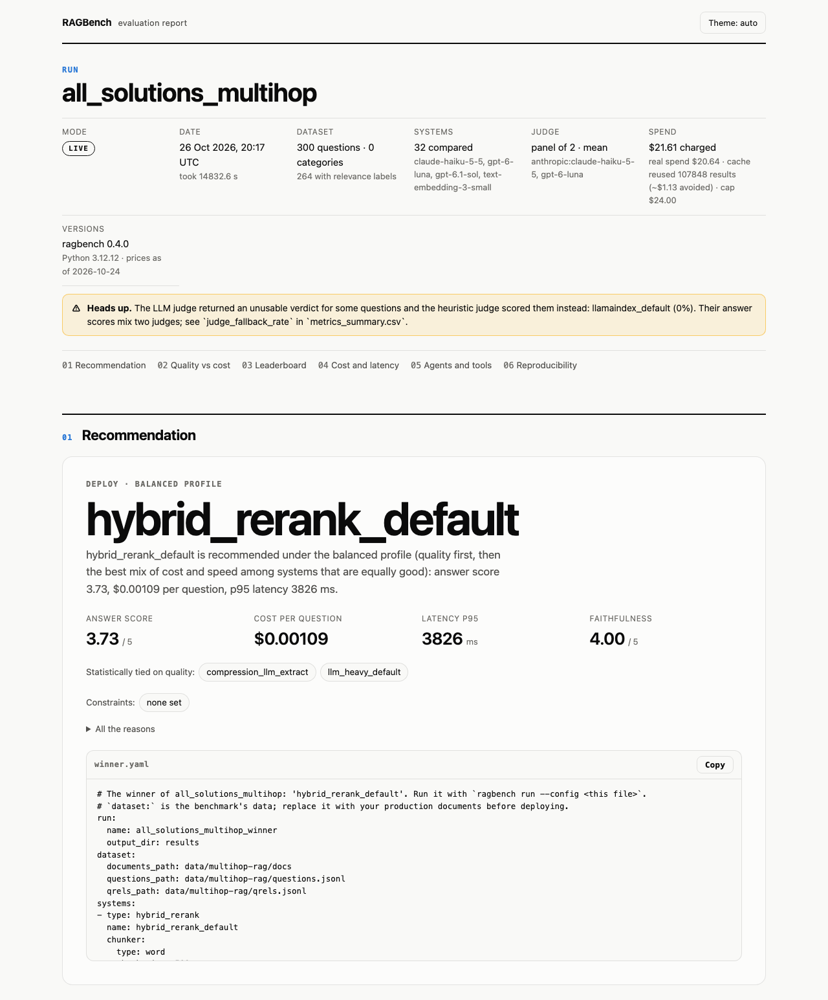
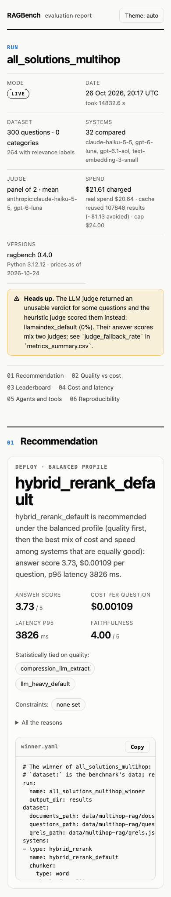

# MultiHop-RAG: every RAG solution on one public dataset

This is RAGBench's published benchmark. **Every RAG solution RAGBench can run** (its built-in pipelines and agents, three frameworks' tutorial pipelines and three agent harnesses) answers the same 300 questions over the same corpus of news articles, with one generator and a judge from another model family. A second run swaps the generator for six open-weight models. Every number on this page is generated from the result files in [`multihop-rag-run/`](multihop-rag-run/), [`multihop-rag-harnesses-run/`](multihop-rag-harnesses-run/) and [`multihop-rag-models-run/`](multihop-rag-models-run/) by `scripts/check_results.py`, and CI fails if the page and the files disagree. What the metrics mean is in the [methodology](../methodology.md).

## The run

| | |
| --- | --- |
| Dataset | [MultiHop-RAG](https://github.com/yixuantt/MultiHop-RAG) (Tang and Yang, 2024; [ODC-By-1.0](https://opendatacommons.org/licenses/by/1-0/)), revision `71ac0d0bd1f951d2d6b70311f7d2ae404e1ffa82`, pulled with `ragbench datasets pull multihop-rag --subset 300 --seed 42` |
| Questions | 300, a stratified subset (seed 42) that keeps the dataset's mix of inference, comparison and temporal questions and its null queries, which the corpus cannot answer; 264 carry relevance labels |
| Corpus | the whole corpus of news articles: a subset keeps every article, so the others are distractors |
| Systems | 32 entries of [`configs/all_solutions.yaml`](../../configs/all_solutions.yaml) on all 300 questions; its 3 agent harnesses on a stratified 150 of them ([`configs/all_solutions_harnesses.yaml`](../../configs/all_solutions_harnesses.yaml), see [below](#agent-harnesses)) |
| Generator | `gpt-6-luna` for every built-in and framework entry (`llm_heavy` keeps `gpt-6.1-sol`, which is what that system is); the harnesses run their own models: Claude Code on `claude-haiku-5-5`, Codex on `gpt-6-luna`, OpenCode on `z-ai/glm-5.3` |
| Judge | `anthropic:claude-haiku-5-5` scores every answer except Claude Code's, which `gpt-6-luna` scores (`evaluation.judge.scorers: first`): one judge per answer, never of the generator's own family |
| Settings | `trials: 1`, `full_context` at a 50,000-token budget, prices as of 2026-10-24 |
| When | 2026-10-26T20:17:02Z to 2026-10-27T00:24:17Z (main run) |
| Versions | ragbench 0.4.0, Python 3.12.12 |
| Spend | main run $21.61 charged at standalone prices (cap $24.00), $20.64 real after the disk cache; harness run $6.61 charged (cap $7.00), $6.71 real; model comparison $9.08 charged (cap $9.40), $8.86 real |
| Errors | 0 of 9600 question-system pairs in the main run, 1 of 900 in the harness run |

## What it shows

- **Retrieval is most of the score.** Without documents `gpt-6-luna` scores 1.90; 31 of the 31 retrieving systems score significantly more, the best, `llm_heavy_default`, 3.83.
- **A plain pipeline is the pick.** The top is a statistical tie: `llm_heavy_default` (which rewrites queries with `gpt-6.1-sol`) costs $0.00983 a question, the recommended `hybrid_rerank_default` $0.00109, 9× less, at 3.73.
- **Agents did not beat it.** `agent_search_tools` retrieves best (Recall@5 0.693, against 0.668) but answers worse (3.53; `iterative_default` 3.52), with a p95 latency of 13071 ms against 3826 ms. Nor did the long context: `full_context_50k` scores 3.41 for $0.00581 a question.
- **The frameworks' tutorial pipelines retrieve like the built-ins but answer worse.** LangChain, LlamaIndex and Haystack out of the box reach Recall@5 0.579 to 0.591 (`hybrid_default`: 0.565) and answer scores of 2.60 to 2.85, at the same retrieval depth and generator. Most of the gap is the null queries: on the 264 answerable questions they score 2.65 to 3.01 (`hybrid_default`: 3.09), on the 36 null queries 0.59 to 2.22 (`hybrid_default`: 4.37): the tutorials' prompts do not make the model say when the passages lack the answer, so it often answers anyway.
- **Two agent harnesses match the recommended pipeline, at 12× the cost (Claude Code) and probably 26–40× ([OpenCode](#opencodes-cost)).** On the same 150 questions OpenCode (GLM 5.3) scores 3.64 and Claude Code (Haiku 5.5) 3.55 against `hybrid_rerank_default`'s 3.65 (Holm p 0.90 and 0.85), for $0.01023 as recorded (OpenRouter probably billed $0.028–$0.043) and $0.01353 a question against $0.00109, with p95 latencies of 22541 ms and 31459 ms. Codex scores 2.92 (−0.73, Holm p 0.005).
- **GraphRAG does not help here.** `graph_rag_local` scores 3.26, level with `hybrid_default` (3.25); `graph_rag_global` scores 2.04, near the floor: global search reads community summaries, which suit questions about a whole corpus, not a fact spread over two articles.
- **Abstaining is a trade.** `decision_gate_strict` is best on the null queries (4.84, against 4.38 for `hybrid_rerank_default`) and the most faithful system (4.50), but it also refuses 62% of the answerable questions (`hybrid_rerank_default`: 8%) and scores 2.60 overall.
- **Open-weight generators come close.** Averaged over the three systems of the [model comparison](#open-weight-generators), GLM 5.3 scores 3.59 and MiMo V2.6 Pro 3.55, against 3.50 for `gpt-6-luna`; DeepSeek V4.1 Flash scores 2.82 in `hybrid_rerank_default` but 3.60 as an agent.

## Recommendation

- `hybrid_rerank_default` is recommended under the `balanced` profile (quality first, then the best mix of cost and speed among systems that are equally good): answer score 3.73, $0.00109 per question, p95 latency 3826 ms.
- `hybrid_rerank_default` ties with `compression_llm_extract` and `llm_heavy_default` on answer score: they are statistically indistinguishable from the best (`llm_heavy_default`) by a paired bootstrap on the same questions (Holm-adjusted p ≥ 0.05). Quality does not separate them, so it wins on cost and latency ($0.00109 per question against up to $0.00983; p95 latency 3826 ms against up to 8092 ms).
- hybrid_rerank_default vs llm_heavy_default (the best answer score): -0.11 answer score (95% CI -0.22 to -0.00, significant), 0.1× cost
- hybrid_rerank_default vs no_retrieval_floor (the cheapest feasible system): +1.82 answer score (95% CI +1.67 to +1.97, significant), 5.2× cost

The full reasoning is in [`recommendation.md`](multihop-rag-run/recommendation.md) and the winner's config in [`winner.yaml`](multihop-rag-run/winner.yaml).

## Leaderboard

Every entry, sorted by answer score (0 to 5). Brackets are 95% bootstrap confidence intervals over the questions each system answered. ✓ marks the Pareto front on answer score, cost and latency. `$ / correct` is the cost per answer scoring at least 4.0. † marks the harnesses, measured on 150 of the 300 questions in a run of their own: compare them with the others through [their own table](#agent-harnesses), which has three of these systems on the same questions.

| System | Type | Recall@5 | MRR@10 | Answer score | Faithfulness | $ / question | $ / correct | p95 latency | Errors | Pareto |
| --- | --- | --- | --- | --- | --- | --- | --- | --- | --- | --- |
| `llm_heavy_default` | llm_heavy | 0.667 [0.627, 0.708] | 0.762 | 3.83 [3.73, 3.94] | 4.11 | $0.00983 | $0.01647 | 8092 ms | 0 | ✓ |
| `hybrid_rerank_default` | hybrid_rerank | 0.668 [0.629, 0.710] | 0.734 | 3.73 [3.61, 3.83] | 4.00 | $0.00109 | $0.00209 | 3826 ms | 0 | ✓ |
| `compression_llm_extract` | compression | 0.640 [0.601, 0.682] | 0.757 | 3.72 [3.57, 3.85] | 4.20 | $0.00112 | $0.00179 | 7614 ms | 0 |  |
| `corrective_default` | corrective | 0.637 [0.599, 0.678] | 0.784 | 3.68 [3.57, 3.79] | 4.20 | $0.00100 | $0.00188 | 9877 ms | 0 | ✓ |
| `rerank_default` | rerank | 0.660 [0.620, 0.701] | 0.743 | 3.65 [3.54, 3.76] | 3.96 | $0.00108 | $0.00210 | 2784 ms | 0 | ✓ |
| `bm25_default` | bm25 | 0.624 [0.585, 0.667] | 0.732 | 3.62 [3.50, 3.74] | 4.06 | $0.00104 | $0.00205 | 2298 ms | 0 | ✓ |
| `decompose_default` | decompose | 0.623 [0.584, 0.665] | 0.635 | 3.61 [3.49, 3.72] | 4.01 | $0.00087 | $0.00184 | 6084 ms | 0 | ✓ |
| `contextual_default` | contextual | 0.630 [0.591, 0.670] | 0.708 | 3.60 [3.48, 3.71] | 4.06 | $0.00104 | $0.00217 | 2771 ms | 0 | ✓ |
| `rag_fusion_default` | rag_fusion | 0.618 [0.580, 0.659] | 0.713 | 3.58 [3.47, 3.70] | 4.17 | $0.00085 | $0.00173 | 6168 ms | 0 | ✓ |
| `adaptive_default` | adaptive | 0.644 [0.603, 0.687] | 0.716 | 3.57 [3.44, 3.69] | 4.06 | $0.00088 | $0.00175 | 4143 ms | 0 | ✓ |
| `decision_gate_default` | decision_gate | 0.668 [0.629, 0.710] | 0.734 | 3.55 [3.40, 3.69] | 4.26 | $0.00181 | $0.00341 | 3611 ms | 0 | ✓ |
| `agent_search_tools` | agent_search | 0.693 [0.653, 0.735] | 0.702 | 3.53 [3.40, 3.64] | 3.64 | $0.00259 | $0.00568 | 13071 ms | 0 |  |
| `iterative_default` | iterative | 0.618 [0.576, 0.661] | 0.680 | 3.52 [3.40, 3.63] | 4.05 | $0.00123 | $0.00266 | 10908 ms | 0 |  |
| `vector_default` | vector | 0.584 [0.546, 0.628] | 0.673 | 3.48 [3.36, 3.59] | 4.03 | $0.00106 | $0.00237 | 2105 ms | 0 | ✓ |
| `hierarchical_default` | hierarchical | 0.559 [0.518, 0.601] | 0.677 | 3.45 [3.31, 3.58] | 4.09 | $0.00076 | $0.00159 | 2309 ms | 0 | ✓ |
| `vector_mmr` | vector | 0.584 [0.544, 0.627] | 0.671 | 3.44 [3.31, 3.57] | 3.95 | $0.00102 | $0.00230 | 2519 ms | 0 | ✓ |
| `sentence_window_default` | sentence_window | 0.582 [0.541, 0.623] | 0.702 | 3.44 [3.30, 3.56] | 4.17 | $0.00051 | $0.00108 | 3254 ms | 0 | ✓ |
| `hyde_default` | hyde | 0.600 [0.562, 0.642] | 0.677 | 3.44 [3.32, 3.56] | 3.96 | $0.00111 | $0.00264 | 4126 ms | 0 |  |
| `full_context_50k` | full_context | 0.642 [0.602, 0.684] | 0.736 | 3.41 [3.29, 3.53] | 3.06 | $0.00581 | $0.01544 | 3329 ms | 0 |  |
| `late_interaction_rerank` | late_interaction | 0.582 [0.543, 0.623] | 0.734 | 3.41 [3.28, 3.54] | 4.15 | $0.00076 | $0.00188 | 2546 ms | 0 |  |
| `parent_doc_default` | parent_doc | 0.600 [0.562, 0.642] | 0.686 | 3.40 [3.26, 3.53] | 3.82 | $0.00123 | $0.00286 | 2905 ms | 0 |  |
| `raptor_collapsed` | raptor | 0.549 [0.512, 0.593] | 0.653 | 3.36 [3.24, 3.49] | 4.09 | $0.00076 | $0.00180 | 2245 ms | 0 | ✓ |
| `agent_search_plain` | agent_search | 0.662 [0.622, 0.706] | 0.701 | 3.35 [3.22, 3.48] | 3.49 | $0.00226 | $0.00547 | 10607 ms | 0 |  |
| `grep_agent_default` | grep_agent | 0.533 [0.492, 0.578] | 0.570 | 3.30 [3.15, 3.42] | 3.57 | $0.00309 | $0.00793 | 8792 ms | 0 |  |
| `graph_rag_local` | graph_rag | 0.534 [0.495, 0.576] | 0.633 | 3.26 [3.13, 3.39] | 4.13 | $0.00092 | $0.00264 | 2431 ms | 0 |  |
| `hybrid_default` | hybrid | 0.565 [0.524, 0.606] | 0.648 | 3.25 [3.12, 3.38] | 3.90 | $0.00106 | $0.00304 | 3255 ms | 0 |  |
| `langchain_default` | python_callable | 0.588 [0.549, 0.630] | 0.702 | 2.85 [2.73, 2.98] | 3.50 | $0.00088 | $0.00914 | 8353 ms | 0 |  |
| `haystack_default` | python_callable | 0.579 [0.543, 0.620] | 0.696 | 2.71 [2.57, 2.84] | 3.04 | $0.00115 | $0.01331 | 10978 ms | 0 |  |
| `decision_gate_strict` | decision_gate | 0.668 [0.629, 0.710] | 0.734 | 2.60 [2.41, 2.78] | 4.50 | $0.00154 | $0.00425 | 2374 ms | 0 | ✓ |
| `llamaindex_default` | python_callable | 0.591 [0.552, 0.634] | 0.671 | 2.60 [2.46, 2.73] | 3.08 | $0.00176 | $0.01430 | 5798 ms | 0 |  |
| `graph_rag_global` | graph_rag | 0.131 [0.104, 0.161] | 0.188 | 2.04 [1.88, 2.19] | 3.33 | $0.00061 | $0.00381 | 3087 ms | 0 |  |
| `no_retrieval_floor` | no_retrieval | — | — | 1.90 [1.76, 2.05] | 2.45 | $0.00021 | $0.00251 | 1754 ms | 0 | ✓ |
| `claude_code`† | cli_agent | 0.632 [0.574, 0.692] | 0.693 | 3.55 [3.35, 3.76] | 3.50 | $0.01353 | $0.02636 | 31459 ms | 0 |  |
| `codex`† | cli_agent | 0.473 [0.410, 0.536] | 0.514 | 2.92 [2.73, 3.12] | 2.54 | $0.01598 | $0.06145 | 40058 ms | 0 |  |
| `opencode_glm`† | cli_agent | 0.656 [0.596, 0.714] | 0.737 | 3.64 [3.50, 3.77] | 3.03 | $0.01023 | $0.02275 | 22541 ms | 1 |  |

## Where systems differ

### Against `no_retrieval_floor`

Paired bootstrap on the same questions, Holm-adjusted over every system, against `no_retrieval_floor` (cheapest system; answer score 1.90, the model without documents).

| System | Difference in answer score | 95% CI | Holm p | Wins / ties / losses |
| --- | --- | --- | --- | --- |
| `llm_heavy_default` | +1.93 | +1.79 to +2.08 | 0.031 | 273 / 8 / 19 |
| `hybrid_rerank_default` | +1.82 | +1.67 to +1.97 | 0.031 | 263 / 13 / 24 |
| `compression_llm_extract` | +1.81 | +1.65 to +1.98 | 0.031 | 263 / 22 / 15 |
| `corrective_default` | +1.78 | +1.63 to +1.93 | 0.031 | 260 / 14 / 26 |
| `rerank_default` | +1.74 | +1.60 to +1.89 | 0.031 | 259 / 10 / 31 |
| `bm25_default` | +1.72 | +1.56 to +1.88 | 0.031 | 258 / 18 / 24 |
| `decompose_default` | +1.70 | +1.55 to +1.86 | 0.031 | 262 / 9 / 29 |
| `contextual_default` | +1.69 | +1.54 to +1.85 | 0.031 | 256 / 13 / 31 |
| `rag_fusion_default` | +1.68 | +1.52 to +1.84 | 0.031 | 259 / 10 / 31 |
| `adaptive_default` | +1.67 | +1.51 to +1.83 | 0.031 | 257 / 14 / 29 |
| `decision_gate_default` | +1.65 | +1.49 to +1.81 | 0.031 | 246 / 35 / 19 |
| `agent_search_tools` | +1.63 | +1.47 to +1.77 | 0.031 | 255 / 15 / 30 |
| `iterative_default` | +1.62 | +1.46 to +1.77 | 0.031 | 250 / 18 / 32 |
| `vector_default` | +1.57 | +1.43 to +1.73 | 0.031 | 251 / 17 / 32 |
| `hierarchical_default` | +1.54 | +1.40 to +1.70 | 0.031 | 250 / 14 / 36 |
| `vector_mmr` | +1.54 | +1.39 to +1.69 | 0.031 | 244 / 26 / 30 |
| `sentence_window_default` | +1.53 | +1.38 to +1.69 | 0.031 | 250 / 20 / 30 |
| `hyde_default` | +1.53 | +1.39 to +1.68 | 0.031 | 250 / 14 / 36 |
| `full_context_50k` | +1.51 | +1.36 to +1.66 | 0.031 | 251 / 13 / 36 |
| `late_interaction_rerank` | +1.50 | +1.34 to +1.67 | 0.031 | 243 / 19 / 38 |
| `parent_doc_default` | +1.49 | +1.34 to +1.67 | 0.031 | 238 / 18 / 44 |
| `raptor_collapsed` | +1.46 | +1.30 to +1.63 | 0.031 | 243 / 15 / 42 |
| `agent_search_plain` | +1.45 | +1.30 to +1.62 | 0.031 | 243 / 17 / 40 |
| `grep_agent_default` | +1.39 | +1.23 to +1.55 | 0.031 | 236 / 20 / 44 |
| `graph_rag_local` | +1.36 | +1.20 to +1.51 | 0.031 | 240 / 19 / 41 |
| `hybrid_default` | +1.35 | +1.20 to +1.50 | 0.031 | 243 / 19 / 38 |
| `langchain_default` | +0.95 | +0.78 to +1.14 | 0.031 | 233 / 9 / 58 |
| `haystack_default` | +0.81 | +0.60 to +1.02 | 0.031 | 231 / 13 / 56 |
| `decision_gate_strict` | +0.69 | +0.52 to +0.87 | 0.031 | 164 / 68 / 68 |
| `llamaindex_default` | +0.69 | +0.54 to +0.85 | 0.031 | 214 / 15 / 71 |
| `graph_rag_global` | +0.14 | +0.02 to +0.26 | 0.031 | 139 / 58 / 103 |

### Statistically tied with the best

The recommendation compares every system with the best answer score (`llm_heavy_default`, 3.83) by the same paired test. Statistically indistinguishable from it (Holm-adjusted p ≥ 0.05): `hybrid_rerank_default`, `compression_llm_extract`. Every other system scores significantly lower.

### Per category

The best system on each question category (mean answer score in that category).

| Category | Best system | Its score | `no_retrieval_floor` |
| --- | --- | --- | --- |
| comparison_query | `compression_llm_extract` | 3.69 | 1.12 |
| inference_query | `compression_llm_extract` | 4.15 | 2.68 |
| null_query | `decision_gate_strict` | 4.84 | 3.23 |
| temporal_query | `llm_heavy_default` | 3.42 | 1.27 |

### Pareto front

On answer score, cost per question and p95 latency, no system beats these on all three: `bm25_default`, `vector_default`, `rerank_default`, `hybrid_rerank_default`, `llm_heavy_default`, `no_retrieval_floor`, `sentence_window_default`, `vector_mmr`, `contextual_default`, `hierarchical_default`, `raptor_collapsed`, `rag_fusion_default`, `decompose_default`, `corrective_default`, `adaptive_default`, `decision_gate_default`, `decision_gate_strict`.

## Agent harnesses

On this corpus the harnesses cost several times what they did on the demo dataset, more than their share of the budget for 300 questions, so they ran on a stratified 150 (`ragbench datasets pull multihop-rag --subset 150 --seed 42`) next to three systems of the main run, configured identically. Each harness works in a fresh read-only copy of the corpus with file tools only (no shell, no web). Significance is against `hybrid_rerank_default` (3.65 on these questions).

| System | Answer score | Recall@5 | $ / question | p95 latency | Difference vs `hybrid_rerank_default` | Holm p |
| --- | --- | --- | --- | --- | --- | --- |
| `hybrid_rerank_default` | 3.65 [3.50, 3.81] | 0.653 [0.597, 0.709] | $0.00109 | 3305 ms | baseline |  |
| `opencode_glm` | 3.64 [3.50, 3.77] | 0.656 [0.596, 0.714] | $0.01023 | 22541 ms | −0.01 (−0.18 to +0.15) | 0.903 |
| `claude_code` | 3.55 [3.35, 3.76] | 0.632 [0.574, 0.692] | $0.01353 | 31459 ms | −0.10 (−0.34 to +0.14) | 0.854 |
| `agent_search_tools` | 3.44 [3.25, 3.61] | 0.691 [0.637, 0.747] | $0.00264 | 16177 ms | −0.22 (−0.40 to −0.03) | 0.072 |
| `codex` | 2.92 [2.73, 3.12] | 0.473 [0.410, 0.536] | $0.01598 | 40058 ms | −0.73 (−0.94 to −0.52) | 0.005 |
| `no_retrieval_floor` | 1.95 [1.74, 2.17] | — | $0.00021 | 2150 ms | −1.71 (−1.91 to −1.49) | 0.005 |

Codex's cost is its tokens at OpenAI API prices; this run billed them to a ChatGPT login. Retrieval metrics for a harness count the files it read, in reading order.

The harnesses are not uniformly better or worse. Mean answer score by question category, on the same 150 questions:

| Category | Questions | `hybrid_rerank_default` | `claude_code` | `codex` | `opencode_glm` |
| --- | --- | --- | --- | --- | --- |
| comparison_query | 50 | 3.53 | 2.91 | 2.56 | 3.50 |
| inference_query | 48 | 3.94 | 4.31 | 3.43 | 3.84 |
| null_query | 18 | 4.36 | 3.91 | 3.99 | 3.75 |
| temporal_query | 34 | 3.06 | 3.24 | 2.18 | 3.50 |

### OpenCode's cost

**Correction (2026-10-27): OpenCode's cost in this run is too low, probably by 2.74–4.25×.** The $0.01023 a question recorded above is OpenCode's own estimate: its tokens at the OpenRouter catalog price of GLM 5.3, which is the cheapest of the providers OpenRouter routes that model to. OpenRouter billed whichever provider served each request, and OpenCode never sees that bill. RAGBench's own GLM 5.3 calls in the [model comparison](#open-weight-generators) record what OpenRouter billed: 2.74× their tokens at the catalog price in `agent_search_tools` and 4.25× in `hybrid_rerank_default`. At those factors OpenCode cost about $0.028–$0.043 a question, 26–40× `hybrid_rerank_default` and more than Claude Code ($0.01353). Its answer scores are unaffected. OpenCode also sends no routing preferences, so its requests did not carry the config's `openrouter.provider.data_collection: deny`.

The fix is in this release: with an `openrouter:` model, the `opencode` preset sends OpenCode's requests through a local relay that records OpenRouter's bill and applies the config's routing ([`openrouter_relay.py`](../../src/ragbench/rag_systems/openrouter_relay.py)). The figures above are this run's and were not re-measured; the correction is recorded with its source in [`corrections.json`](multihop-rag-harnesses-run/corrections.json).

## Frameworks out of the box

The pipelines each framework's RAG tutorial builds ([`examples/`](../../examples/)), on the same generator and embeddings as the built-in systems:

| System | Answer score | Answerable questions | Null queries | Recall@5 | $ / question |
| --- | --- | --- | --- | --- | --- |
| `langchain_default` | 2.85 [2.73, 2.98] | 3.01 | 1.73 | 0.588 [0.549, 0.630] | $0.00088 |
| `llamaindex_default` | 2.60 [2.46, 2.73] | 2.65 | 2.22 | 0.591 [0.552, 0.634] | $0.00176 |
| `haystack_default` | 2.71 [2.57, 2.84] | 3.00 | 0.59 | 0.579 [0.543, 0.620] | $0.00115 |
| `hybrid_default` (built-in, for reference) | 3.25 [3.12, 3.38] | 3.09 | 4.37 | 0.565 [0.524, 0.606] | $0.00106 |

## Open-weight generators

[`configs/all_solutions_models.yaml`](../../configs/all_solutions_models.yaml): three systems of the main run, configured identically, with each generator, on a stratified 100 of the questions. Answer score (95% CI) and cost per question.

**Read the `anthropic:claude-haiku-5-5` row apart from the others.** Haiku 5.5 judges every other row, and a judge never scores its own model family, so the Haiku-generated answers were scored by `gpt-6-luna` instead. A different judge means a different scale: that row's lead may be the judge, not the model.

| Generator | `hybrid_rerank_default` | `iterative_default` | `agent_search_tools` | $ / question (mean of the three) |
| --- | --- | --- | --- | --- |
| `openrouter:deepseek/deepseek-v4.1-flash` | 2.82 [2.53, 3.11] | 3.12 [2.87, 3.37] | 3.60 [3.41, 3.78] | $0.00172 |
| `openrouter:z-ai/glm-5.3` | 3.61 [3.40, 3.80] | 3.54 [3.35, 3.72] | 3.63 [3.43, 3.81] | $0.00383 |
| `openrouter:moonshotai/kimi-k3` | 3.45 [3.19, 3.69] | 3.56 [3.34, 3.78] | 3.16 [2.92, 3.41] | $0.00941 |
| `openrouter:xiaomi/mimo-v2.6-pro` | 3.58 [3.38, 3.77] | 3.50 [3.34, 3.67] | 3.56 [3.35, 3.76] | $0.00366 |
| `openrouter:qwen/qwen3.8-flash` | 3.50 [3.27, 3.73] | 3.41 [3.18, 3.62] | 3.51 [3.32, 3.69] | $0.00186 |
| `openrouter:minimax/minimax-m3` | 3.43 [3.20, 3.64] | 3.60 [3.40, 3.79] | 3.48 [3.27, 3.69] | $0.00330 |
| `gpt-6-luna` | 3.65 [3.47, 3.83] | 3.44 [3.21, 3.65] | 3.42 [3.21, 3.64] | $0.00164 |
| `anthropic:claude-haiku-5-5` | 3.97 [3.76, 4.17] | 3.84 [3.61, 4.04] | 3.97 [3.78, 4.15] | $0.00221 |

## Patterns across the runs

### Which questions are hard

Mean answer score by question category over the 31 retrieving systems of the main run:

| Category | Questions | Mean | Best system's score | Worst system's score | `no_retrieval_floor` |
| --- | --- | --- | --- | --- | --- |
| null_query | 36 | 4.04 | 4.84 | 0.59 | 3.23 |
| inference_query | 95 | 3.70 | 4.15 | 2.86 | 2.68 |
| comparison_query | 100 | 3.17 | 3.69 | 1.51 | 1.12 |
| temporal_query | 69 | 2.77 | 3.42 | 1.29 | 1.27 |

- **Temporal questions are the hardest.** They ask how two reports relate in time, so a system needs both articles and their dates. 11 of the 300 questions get no answer scoring 4 or more from any of the 32 systems; 7 of them are temporal questions.
- **The null queries separate the systems most**, from 0.59 to 4.84: whether a system says the documents lack the answer matters more than how well it retrieves. The built-in pipelines' prompts ask for that; the frameworks' tutorial prompts do not insist on it ([Frameworks](#frameworks-out-of-the-box)).

### Retrieval explains part of the ranking, cost none of it

Across the 31 retrieving systems, the rank correlation (Spearman) of Recall@5 with the answer score is 0.58, and of the cost per question with the answer score 0.02: a system that spends more on a question does not answer it better for that. Per answer, on the answerable questions:

| Labeled evidence in the top 5 | Answers | Mean answer score |
| --- | --- | --- |
| none of it | 583 | 2.36 |
| some of it | 4,222 | 3.24 |
| all of it | 3,379 | 3.44 |

Finding part of the evidence gets most of the way (3.24 against 2.36); finding all of it adds only +0.20, because a complete context still has to be combined into one answer.

### Why answers fail

4,342 of the main run's 9,600 answers fall short ([failure types](../methodology.md#failure-types)):

| Failure type | Answers | Share of the failures |
| --- | --- | --- |
| `insufficient_context` | 1,589 | 37% |
| `answer_hallucination` | 1,316 | 30% |
| `retrieval_miss` | 387 | 9% |
| `partial_answer` | 379 | 9% |
| `bad_reranking` | 313 | 7% |
| `over_refusal` | 281 | 6% |
| `possible_qrels_gap` | 77 | 2% |

The commonest failure is a half-found question (`insufficient_context`: part of the evidence never reached the generator), the multi-hop failure this dataset is built to provoke; next come answers the context does not support (`answer_hallucination`), which include every null query a system answered anyway.

### A generator's rank depends on the system

In the [model comparison](#open-weight-generators) the eight generators rank differently in each of the three systems: the rank correlation of their answer scores between two systems is 0.10 to 0.33. Pick a generator together with the system it will run in.

In `hybrid_rerank_default`, which reads one fixed set of passages, the open-weight generators refuse 22–51% of the answerable questions, against 9% for `gpt-6-luna`; in `agent_search_tools`, where they can search again, 1–23%.

## Optimizing a system on this dataset

`ragbench optimize` ([how it works](../optimization.md)) tried to improve `hybrid_rerank` on a 151 / 149 train / test split of these questions (Task 22 of the 0.4.0 plan); the full record is in [`multihop-rag-optimize/`](multihop-rag-optimize/optimization.md). Its verdict, quoted from that file:

**no reliable gain: the base harness is kept.**

On test (149 questions, 1 trial(s)): `p0-dom` 3.645 against the base's 3.682, difference -0.037 (95% CI -0.159 to +0.082), p = 0.5567, Holm-adjusted over 1 comparison(s) p = 0.5567; wins / ties / losses 53 / 32 / 64.

`optimized.yaml` holds `hybrid_rerank` unchanged.
- The splits have no dev questions, so `p0-dom` was picked on train (the best there); the test split still decides.

## Limitations

- **One judge per answer, and an LLM one.** Haiku 5.5 scored almost every answer; its accuracy on this dataset has not been checked against human labels (`ragbench judge-audit`). The answers of Claude Code and of the Haiku rows of the model comparison were scored by `gpt-6-luna`, so they sit on another judge's scale.
- **One trial.** Every question was answered once; differences inside the confidence intervals are noise, and the tied-with-best list is the honest summary of the top.
- **A subset.** 300 of the dataset's questions; the harnesses 150, the open-weight comparison 100.
- **Not a ceiling.** The corpus is far larger than any prompt, so `full_context_50k` reads the articles BM25 ranks first up to its budget, not the whole corpus.
- **Latency** is the mean of a short one-at-a-time probe and moves between runs; compare it only across large differences.
- **News from 2023.** The model may know some of these stories; `no_retrieval_floor` measures how much.
- **GraphRAG's index is not perfect.** A few chunks' entity extraction ran out of output tokens and was left out of the graph (the run logs each one).
- **Refusals worded freely are not counted as refusals.** The abstain and false-refusal columns detect RAGBench's own refusal wording, which its built-in prompts ask for. The framework pipelines and the harnesses phrase refusals their own way, so those columns undercount them; compare them on the judge's null-query score instead ([Per category](#per-category), [Frameworks](#frameworks-out-of-the-box)).
- **OpenCode's cost is under-reported** by about 2.74–4.25× ([correction](#opencodes-cost)); every other system's cost is what its provider billed or its tokens at list price.
- **Framework cost.** LangChain's and Haystack's own OpenAI clients bypass RAGBench's call cache, so their tokens are priced from what they report, and the run's real-spend line leaves them out.

## Files

Each run folder holds `config.yaml`, `metrics_summary.csv`, `significance.csv`, `stats.json`, `run_summary.json`, `run_manifest.json`, the recommendation, the dataset's `hub.json` and `patterns.json` (the per-question counts and means the [patterns](#patterns-across-the-runs) quote, with no question or answer text). `ragbench report docs/benchmarks/multihop-rag-run` rebuilds the leaderboard, the recommendation and `report.html` from them. The per-question rows (questions, answers, passages) are not committed: the articles are third-party news.

  
  

